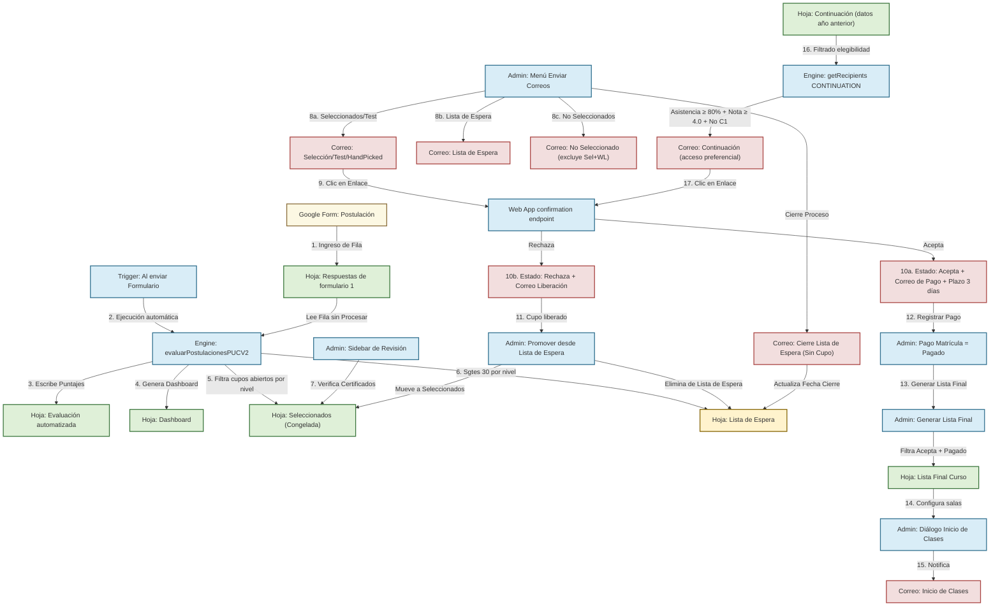

# Flujo Lógico y Operación de Scripts (PUCV2English v2.4.0)

Este documento detalla la arquitectura, requerimientos y secuencia de ejecución del sistema modular **PUCV2English**, diseñado para la gestión y evaluación automatizada de postulaciones.

---

## 🗺️ Diagrama del Flujo de Trabajo General

El siguiente diagrama ilustra el ciclo de vida completo de una postulación, desde el formulario inicial hasta el inicio de clases:

---

## 🧩 Componentes y Requerimientos de los Scripts

A continuación, se detalla qué requiere y qué produce cada script de la carpeta `src/`.

### 1. Config.ts

* **Propósito**: Centraliza tipos, interfaces y objetos globales de configuración.
* **Requerimientos / Entradas**:
    * La hoja de cálculo activa de Google Sheets (contenedor).
    * Una hoja llamada `"Configuración"` para persistir configuraciones personalizadas del usuario.
* **Salidas / Modificaciones**:
    * Expone el objeto `CONFIG` con los nombres exactos de las hojas y columnas del formulario.
    * Expone los parámetros de puntuación predeterminados (`DEFAULT_SCORING_PARAMS`) y de programa (`DEFAULT_PROGRAM_DATA`).
* **Funciones clave**:
    * `cargarConfiguracionDesdeHoja_()`: Lee pesos y configuraciones de la hoja `"Configuración"`.
    * `saveConfiguracion(data)`: Guarda en la hoja `"Configuración"` los cambios de pesos hechos desde el sidebar.
    * `resetConfiguracion()`: Borra la hoja `"Configuración"` y restablece valores predeterminados en memoria.

### 2. Evaluacion.ts

* **Propósito**: Motor de cálculo que evalúa postulaciones aplicando criterios de ponderación.
* **Requerimientos / Entradas**:
    * Hoja `"Respuestas de formulario 1"` con datos estructurados y los encabezados exactos detallados en `CONFIG.COLUMNS`.
    * Columna `"Estado de Procesamiento"` agregada al final de la hoja de respuestas.
* **Salidas / Modificaciones**:
    * Sobrescribe la hoja `"Evaluación automatizada"`.
    * Actualiza la columna `"Estado de Procesamiento"` en `"Respuestas de formulario 1"` con la marca de tiempo de la evaluación.
    * Ejecuta la actualización en cadena de la hoja `"Lista de Espera"` y del `"Dashboard"`.
    * **No sobreescribe** la hoja `"Seleccionados"` (congelada).
* **Funciones clave**:
    * `evaluarPostulacionesPUCV2()`: Lee filas no procesadas, realiza la validación de duplicados por correo, calcula los puntajes detallados, escribe los resultados e invoca a las hojas derivadas.
    * `calcularPuntajeUsoIngles_()`, `calcularPuntajeInternacionalizacion_()`, `calcularPuntajeCertificado_()`, `calcularPuntajeAnioIngreso_()`: Funciones modulares que calculan los puntajes de acuerdo al perfil del postulante.
    * `motivoNoElegible_()`: Aplica los requisitos e impedimentos de las bases (n.º 4, 5.1 y 5.2). Si devuelve un motivo, la fila se marca `NO ELEGIBLE: <motivo>` en `Estado de Procesamiento` y no se evalúa.
    * **Pauta**: Uso del inglés y respaldo de jefatura solo aplican a académicos y funcionarios; el año de ingreso solo a pregrado (desde 3.er año, 2 pts); Alumni queda en 0. Disponibilidad y compromisos no puntúan. El desempate usa `compararPostulantes_()` (n.º 7.5).
    * `normalizarFecha_()` / `formatearColumnaFecha_()` (`Utils.ts`): guardan la marca temporal como fecha real y la muestran como `dd/MM/yyyy HH:mm`.

### 3. Seleccionados.ts

* **Propósito**: Seleccionar, ordenar y gestionar a los postulantes, incluyendo lista de espera y promociones.
* **Requerimientos / Entradas**:
    * Los resultados generados por el motor de evaluación (`resultados`).
    * La hoja `"Evaluación automatizada"` (para buscar candidatos de lista de espera).
    * La hoja `"Seleccionados"` existente (para preservar datos y promociones manuales).
* **Salidas / Modificaciones**:
    * **`"Seleccionados"` (congelada)**: Solo se genera al inicio; las regeneraciones posteriores no la sobreescriben.
    * **`"Lista de Espera"`**: Hoja con los siguientes 30 candidatos por nivel, ordenados por puntaje. Preserva las fechas de notificación y cierre existentes.
    * Aplica validación de datos a las columnas de gestión (`Aceptación`, `Verificación Certificado`, `Nivel Asignado`, `Pago Matrícula`).
    * Aplica formato condicional de color (verde para aceptados, rojo para rechazados).
* **Funciones clave**:
    * `generarHojaSeleccionados_()`: Selecciona a los mejores de cada nivel según sus **cupos abiertos** (B1+ 25; B2.1, B2.2 y C1 15 cada uno). Solo se ejecuta si la hoja no existe o está vacía.
    * `generarHojaListaEspera_()`: Genera los siguientes 30 candidatos por nivel, preservando las fechas de notificación y cierre existentes, y excluyendo a los ya seleccionados.
    * `promoverDesdeListaEspera()`: Mueve al candidato seleccionado de la fila activa de la lista de espera a `"Seleccionados"`, lo elimina de la lista de espera y re-secuencia los rankings.
    * `restaurarHojaSeleccionadosPerdida()`: Recuperación de emergencia con datos backup hardcoded.

### 4. Correos.ts

* **Propósito**: Motor de envío de correos masivos o unitarios con plantillas HTML personalizadas.
* **Requerimientos / Entradas**:
    * Hojas `"Seleccionados"`, `"Lista de Espera"`, `"Evaluación automatizada"` y `"Continuación"`.
    * Plantillas HTML: `CorreoSeleccionado`, `CorreoTestNivel`, `CorreoHandPicked`, `CorreoListaEspera`, `CorreoEsperaSinCupo`, `CorreoNoSeleccionado`, `CorreoContinuacion`, `CorreoConfirmacionAcepta`, `CorreoConfirmacionRechaza`.
    * Cada plantilla contiene solo su contenido: el estilo, el logo y el pie vienen de los fragmentos `CorreoBase_Estilos`, `CorreoBase_Cabecera` y `CorreoBase_Pie` (`<?!= incluir('CorreoBase_Pie') ?>`). Un cambio de logo o de pie se hace en un solo archivo. `CorreoPlacementTest` tiene diseño propio y no los usa.
* **Tabla de tipos (`CORREOS`)**: cada tipo de lote declara su plantilla, asunto, asunto de prueba, hoja y columna donde se sella la fecha, y si lleva enlaces con token. `TipoCorreo` es un tipo cerrado: TypeScript falla si falta una entrada.
* **Cómo agregar un tipo de correo**: (1) entrada en `CORREOS`, (2) rama en `getRecipients_()`, (3) ítem de menú en `Menu.ts` con su función de una línea, (4) la plantilla HTML. `sendTestEmail` y la cadena completa de pruebas lo incluyen solos.
* **Salidas / Modificaciones**:
    * Envía correos electrónicos a través de `GmailApp` o crea borradores según la opción elegida.
    * Registra la fecha y hora en la columna de control correspondiente para asegurar idempotencia.
* **Tipos de Lote Soportados**:
    * `SELECTED`: Candidatos con `Verificación Certificado = "Válido"` y sin fecha de notificación.
    * `TEST_LEVEL_ONLY`: Candidatos con `Verificación Certificado = "Test de nivel"` y sin fecha de notificación.
    * `HAND_PICKED`: Candidatos seleccionados manualmente fuera de plazo.
    * `WAITLIST`: Candidatos en la hoja `"Lista de Espera"` sin fecha de notificación.
    * `WAITLIST_REJECTED`: Candidatos en `"Lista de Espera"` sin `"Fecha Notificación Cierre"`.
    * `NO_SELECTED`: Todos los evaluados que **no** estén en `"Seleccionados"` ni en `"Lista de Espera"`.
    * `CONTINUATION`: Estudiantes del año anterior con asistencia ≥ 80%, nota ≥ 4.0 (40/70), y curso con continuación (excluye C1). Lee de la hoja `"Continuación"`.

### 5. WebApp.ts

* **Propósito**: Sirve el panel de control web (Dashboard) y gestiona los endpoints de confirmación (`doGet`) para las respuestas de los postulantes.
* **Gestión de Tokens y Respuestas**:
    * Genera tokens UUID de un solo uso asociados al correo del postulante.
    * Al recibir `action=accept` o `action=reject`:
        1. Busca al candidato en la hoja `"Seleccionados"`. Si existe, actualiza la columna `"Aceptación"`.
        2. Si no se encuentra en `"Seleccionados"`, busca en la hoja `"Continuación"`. Si existe, crea la columna `"Aceptación"` si no estuviera y registra el estado (`"Acepta"` o `"Rechaza"`).
        3. Para estudiantes de continuación que aceptan, la WebApp muestra una página de confirmación personalizada notificando que su cupo está formalizado sin necesidad de pago de matrícula.
* **Funciones clave**:
    * `getRecipients_(type)`: Selecciona los destinatarios según el tipo de lote, aplicando filtros de idempotencia y exclusión.
    * `sendEmailBatch(type, asDraft, limit)`: Arma el lote según `CORREOS[type]` y lo envía con `enviarLote_()`; crea la columna de sello si falta.
    * `sendTestEmail(email, type)`: Envía un correo de ejemplo de cualquier tipo de `CORREOS` o `CORREOS_PRUEBA_EXTRA`; `CADENA_COMPLETA` los envía todos (11).
    * `enviarCorreoConfirmacion_(correo, tipoConfirmacion)`: Envía correos automáticos al aceptar (con link de pago y plazo dinámico) o rechazar.
    * `previewEmailBatch(type)`: Retorna un preview de los destinatarios sin enviar.

### 5. InicioClases.ts

* **Propósito**: Notificar el inicio del curso a los alumnos definitivamente matriculados.
* **Requerimientos / Entradas**:
    * Hoja `"Lista Final Curso"`.
    * Plantilla HTML `CorreoInicioClases`.
    * Entrada de texto del administrador para definir las salas físicas/virtuales de cada nivel.
* **Salidas / Modificaciones**:
    * Envía correos con horarios, sala y fechas a través de `GmailApp`.
    * Escribe la sala en la columna `"Sala"` y la fecha de envío en `"Notificado Inicio"` de la hoja `"Lista Final Curso"`.
* **Funciones clave**:
    * `getNivelesActivos()`: Obtiene niveles con alumnos confirmados no notificados.
    * `guardarSalasYObtenerPreview(salas)`: Guarda temporalmente la relación nivel-sala y retorna un preview.
    * `enviarCorreosInicioClases()`: Ejecuta la lógica final de envío de correos y marcas de tiempo.

### 6. ListaFinal.ts

* **Propósito**: Genera el libro de clases definitivo en la hoja `"Lista Final Curso"`.
* **Lógica de Consolidación**:
    1. Filtra candidatos de `"Seleccionados"` que tengan `Aceptación` = `"Acepta"` **Y** `Pago Matrícula` = `"Pagado"`.
    2. Lee la hoja `"Continuación"` y filtra a los estudiantes con `Aceptación` = `"Acepta"`. Mapea su curso anterior al nuevo nivel (ej: `B1+ → B2.1`) y los marca como `"Exento (Continuación)"` en la columna `"Pagó (Sí/No)"`.
    3. Agrupa a todos los confirmados por nivel (o `"PRUEBA DE NIVEL"`) y construye la lista dividida por categorías con encabezados destacados.

### 7. WebApp.ts

* **Propósito**: Maneja el panel de control administrativo web (UI principal) y los endpoints para que los postulantes confirmen o liberen su cupo.
* **Requerimientos / Entradas**:
    * Acceso a `ScriptProperties` para almacenar y validar tokens temporales UUID de confirmación.
    * `index.html` para la interfaz del panel.
* **Salidas / Modificaciones**:
    * Registros de aceptación/rechazo en la hoja `"Seleccionados"`.
    * Páginas web dinámicas de confirmación para los postulantes.
    * Datos de la lista de espera y estado de pago para la Web App.
* **Funciones clave**:
    * `doGet(e)`: Enrutador principal. Procesa decisiones de postulantes o muestra el Panel de Control.
    * `procesarAccionPostulante_(token, action)`: Valida el token único, actualiza la hoja, destruye el token (un solo uso) y envía el correo de confirmación.
    * `generarToken_(correo)`: Genera un UUID único en ScriptProperties para el postulante.
    * `getSelectionData()`: Retorna datos de seleccionados y lista de espera para el panel web, incluyendo estado de pago.

### 8. Menu.ts

* **Propósito**: Define el menú personalizado de Google Sheets con todas las acciones administrativas.
* **Opciones de Menú**:
    * 📊 Evaluar Postulaciones / 🔄 Reevaluar Todo desde Cero
    * 📋 Generar Lista Final
    * 🔄 Regenerar Lista de Espera
    * 👤 Promover desde Lista de Espera
    * ⚠️ Restaurar Hoja Seleccionados Perdida
    * ⚙️ Configurar Pesos / 👁️ Revisar Postulaciones
    * 📧 Enviar Correos (submenú con 9 opciones)
    * 📈 Ver Dashboard

### 9. Utils.ts

* **Propósito**: Funciones de soporte transversales (normalización, logs de depuración, conversiones de celdas).
* `incluir_(nombre)` y `renderPlantilla_(nombre, vars)`: evalúan fragmentos y plantillas HTML. `renderPlantilla_` reemplaza el antiguo patrón `(htmlBody as any).campo = ...`.
* `leerHoja_(nombre)`: lee una hoja completa y devuelve `{ hoja, headers, filas, col(), colOpc() }`. `h.col(HEADERS.X)` lanza un error claro (`Falta la columna "X" en la hoja "Y"`) si el encabezado no existe, en vez de devolver `-1` y fallar en silencio; `h.colOpc()` es para columnas que pueden faltar. La fila `i` de `h.filas` está en la posición `i + 2` de la hoja. Lo usan `Correos.ts` y los escritores de `WebApp.ts`.
* `mensajeError_(e)`: texto legible de un error capturado. En TypeScript el `catch` entrega `unknown`, así que se escribe `catch (e)` y `mensajeError_(e)` en vez de `e.message`.

### 9b. EnvioLote.ts

* **Propósito**: Envío por lote compartido por `Correos.ts`, `InicioClases.ts` y `RechazoPorNivel.ts` (`Placement.ts` conserva su propio flujo: marca por casilla, adjunto PDF y estado en texto).
* **`enviarLote_(opciones)`**: Revisa la cuota (solo en envíos reales; los borradores no consumen), procesa cada destinatario con `try/catch` (un error no detiene el lote), y tras un envío real sella la fecha en la hoja indicada, que es lo que evita reenviar al volver a ejecutar. Devuelve el mensaje para la UI.
* **`asegurarColumna_(hoja, encabezado)`**: Devuelve la columna con ese encabezado y la crea si no existe, para que nunca falte el sello.

### Convenciones del código

* **Funciones públicas y privadas**: en Apps Script cualquier función global puede llamarse desde el navegador con `google.script.run` si el panel web la expone. Las funciones **internas terminan en `_`** (`getRecipients_`, `enviarLote_`…) y no son invocables desde el cliente. Quedan sin `_` solo: los ítems del menú, los disparadores (`onOpen`, `doGet`, `evaluarPostulacionesPUCV2`) y las funciones que llaman `index.html`, los diálogos y los sidebars. Antes de crear una función nueva, decide cuál es y, si el HTML la llama, no le pongas `_`.
* **Encabezados de hojas**: se escriben siempre con `HEADERS.*` (`Config.ts`), nunca como texto suelto. Los encabezados del formulario están en `CONFIG.COLUMNS`.
* **Envíos largos**: `enviarLote_` y el envío de Prueba de Nivel se detienen a los 5 minutos (Apps Script corta a los 6) e indican cuántos quedan. Basta volver a ejecutar: los ya enviados llevan sello de fecha y no se repiten.

### 10. Dashboard.ts

* **Propósito**: Generación de métricas estadísticas y gráficos interactivos en la hoja `"Dashboard"`.

---

## 🔄 Flujo de Trabajo Operacional (Paso a Paso)

### Paso 1: Inicialización y Parámetros

1. El Administrador publica la **Web App** en Google Apps Script.
2. Configura la URL resultante en `CONFIG.WEB_APP_URL` en Config.ts.
3. Configura los horarios del programa y los pesos de ponderación en `PUCV2English` > `⚙️ Configurar Pesos`.

### Paso 2: Admisión de Postulaciones y Puntuación

1. Los postulantes completan el formulario de Google.
2. Un trigger automático ejecuta `evaluarPostulacionesPUCV2()` al enviar el formulario.
3. El motor calcula el puntaje y actualiza:
    * `"Evaluación automatizada"` (listado de puntuaciones).
    * `"Dashboard"` (gráficos y métricas).
    * `"Seleccionados"` (cupos abiertos por nivel: B1+ 25, resto 15; solo la primera vez).
    * `"Lista de Espera"` (Siguientes 30 por nivel, se regenera cada vez).

### Paso 3: Validación Administrativa de Certificados

1. El administrador revisa los certificados en la hoja `"Seleccionados"` o usando el sidebar `👁️ Revisar Postulaciones`.
2. Establece `Verificación Certificado` como `"Válido"` o `"Test de nivel"` según corresponda.

### Paso 4: Notificación y Decisiones de Postulantes

1. **Envío de invitaciones** con enlaces únicos de Aceptar/Rechazar:
    * `📧 Enviar Correos` → `✅ Seleccionados` (certificado válido)
    * `📧 Enviar Correos` → `🧪 Test de Nivel` (requiere examen)
    * `📧 Enviar Correos` → `💎 Hand Picked` (seleccionados manualmente)
2. **Notificación de lista de espera**: `📧 Enviar Correos` → `⏳ Lista de Espera`.
3. **Correos de rechazo**: `📧 Enviar Correos` → `❌ No Seleccionados` (excluye automáticamente a seleccionados y lista de espera).
4. El postulante responde haciendo clic en el correo:
    * **Aceptar**: Estado cambia a `"Acepta"`, se envía correo de confirmación con URL de pago y plazo dinámico de 3 días.
    * **Rechazar**: Estado cambia a `"Rechaza"`, se envía correo de confirmación de liberación.

### Paso 5: Gestión de Pagos y Promoción (Iterativo)

1. El administrador registra pagos en la columna `Pago Matrícula` de `"Seleccionados"`.
2. Si se liberan cupos (rechazos o vencimientos de plazo), se promueven candidatos desde la lista de espera:
    * Seleccionar la fila en `"Lista de Espera"` → `👤 Promover desde Lista de Espera`.
    * El candidato se mueve a `"Seleccionados"` y se elimina de la lista de espera automáticamente.

### Paso 6: Cierre de la Lista de Espera

1. Cuando el proceso de matrícula concluye sin más vacantes:
    * `📧 Enviar Correos` → `⏳ Cierre Lista de Espera (Sin Cupo)`.
    * Los candidatos restantes en la lista de espera reciben el correo de cierre definitivo.
    * La columna `"Fecha Notificación Cierre"` registra la fecha del aviso.

### Paso 7: Generación de Lista Final e Inicio de Clases

1. El administrador ejecuta `📋 Generar Lista Final`.
2. Solo se incluyen candidatos con `Acepta` + `Pagado`.
3. El administrador selecciona `📧 Enviar Correos` → `🏫 Inicio de Clases`.
4. Introduce la sala para cada nivel, valida el preview y confirma el envío.
5. Los alumnos reciben el correo de bienvenida con horarios, salas y fechas.

### Paso 8: Continuación de Estudiantes del Año Anterior

1. Al iniciar un nuevo período, el coordinador obtiene el informe de notas y asistencia del año anterior.
2. Pega los datos en la hoja **`"Continuación"`** con las columnas: `Name`, `Surname`, `ID`, `Curso`, `Profesor`, `Asistencia`, `Promedio Final`.
3. Agrega manualmente las columnas `Email` (con los correos de los estudiantes) y `Fecha Notificación` (vacía).
4. El sistema filtra automáticamente a los elegibles:
    * Asistencia ≥ 80%
    * Promedio Final ≥ 40 (equivalente a 4.0)
    * Curso con continuación (B1+ → B2.1, B2.1 → B2.2, B2.2 → C1). Se excluye C1.
5. Ejecuta `📧 Enviar Correos` → `🔄 Continuación` (o `sendEmailBatch('CONTINUATION')`).
6. Los estudiantes elegibles reciben el correo `CorreoContinuacion` con:
    * Su curso anterior y el nivel al que pueden avanzar
    * Horarios del nuevo curso
    * Botones de Aceptar/Rechazar
7. Al aceptar, el estudiante se incorpora a las listas finales sin pago de matrícula.

---

## 🛡️ Robustez, Concurrencia e Idempotencia

* **Lock Service**: El motor de evaluación y la gestión de lista de espera bloquean la hoja con `LockService` durante el proceso de lectura/escritura para evitar sobrescrituras por solicitudes paralelas.
* **Idempotencia de Envíos**: Cada tipo de envío tiene su propia columna de control de fecha (`Fecha Notificación`, `Fecha Notificación Cierre`, `Notificado Inicio`). Una vez enviado con éxito, el timestamp impide duplicaciones.
* **Exclusión Segura**: Los correos de rechazo (`NO_SELECTED`) filtran en caliente las hojas `"Seleccionados"` y `"Lista de Espera"` para no enviar rechazos a candidatos que aún tienen una oportunidad.
* **Modo Borrador**: Antes de cualquier envío masivo, el administrador puede optar por crear borradores en Gmail (con opción de limitar a 5 muestras) para revisar el contenido antes de enviar realmente.
* **Sandbox de Pruebas**: Si un enlace de confirmación se activa con un token de test que no pertenece a ningún correo real, el script opera en modo seguro de simulación, previniendo escrituras erróneas.
